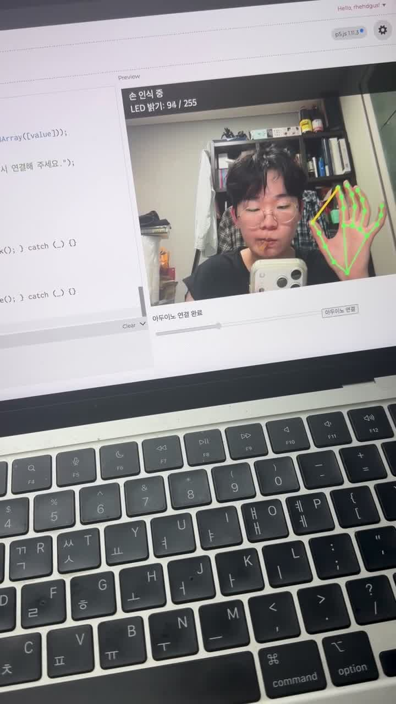

# 손가락으로 LED 밝기 제어하기

웹캠과 **p5.js / ml5.js HandPose**로 엄지와 검지 사이의 간격을 인식하고, **Web Serial API**로 Arduino Uno의 **D13 LED 밝기**를 제어하는 인터랙티브 시스템입니다. 별도의 시리얼 중계 서버 없이 Chrome과 아두이노를 USB로 직접 연결합니다.

## 1. 과제 목표 및 구현 내용

| 과제 조건 | 구현 방법 |
|---|---|
| 엄지와 검지 간격으로 p5 슬라이더 조절 | 손의 21개 관절 중 엄지 끝 4번, 검지 끝 8번 좌표의 거리 계산 |
| 슬라이더 값을 아두이노로 전송 | 0~255 값을 Web Serial로 약 80ms마다 1바이트 전송 |
| 연결된 LED 밝기 조절 | D13 핀에 소프트웨어 PWM 적용 |
| GitHub에 내용 정리 | 소스 코드, 회로 설명, 시연 영상 및 실행 방법 수록 |

강의 수강과 LMS 댓글 제출은 별도 수행 항목입니다.

## 2. 시연 영상

[](assets/demo.mp4)

**[시연 영상 보기 / 다운로드](https://github.com/GODONGYEN/handpose-led-control/raw/refs/heads/main/assets/demo.mp4)**

제공된 촬영 영상을 웹 호환 MP4(H.264)로 변환했습니다. 미리보기에서 손 관절의 초록색 점·연결선, 엄지와 검지 사이 노란 선, 밝기 값 및 아두이노 연결 상태를 볼 수 있습니다. GitHub에서 영상이 바로 재생되지 않으면 위 링크로 다운로드해 재생할 수 있습니다.

## 3. 준비물 및 회로 구성

- Arduino Uno, USB 데이터 케이블
- LED, 220~330Ω 저항, 브레드보드, 점퍼선
- 웹캠과 Chrome 브라우저

연결: **D13 → 저항 → LED 양극(긴 다리) → LED 음극(짧은 다리) → GND**

저항은 LED와 직렬로 연결합니다. Uno의 내장 L LED도 D13에 연결되어 있습니다.

**Uno의 D13은 하드웨어 PWM 핀이 아닙니다.** 따라서 `analogWrite(13, 값)` 대신 `micros()`를 이용한 소프트웨어 PWM으로 LED가 켜져 있는 시간의 비율을 조절합니다. PWM 주기는 2,000μs(약 500Hz)이며 0은 꺼짐, 255는 최대 밝기입니다.

## 4. 동작 원리

```text
웹캠 → HandPose 손 인식 → 엄지·검지 끝 거리 계산
     → 0~255 슬라이더 값 → Web Serial → Arduino D13 → LED 밝기
```

- `preload()`에서 손 인식 모델을 불러옵니다.
- `detectStart()`가 웹캠에서 손을 연속으로 인식합니다.
- 손가락 간격 25~220px을 0~255로 변환하고 범위를 벗어난 값은 제한합니다.
- 캔버스에 손의 21개 관절과 연결선을 표시합니다.
- 거울처럼 화면을 반전하고 손 표시 좌표도 함께 반전합니다.
- 브라우저가 보내는 한 바이트를 아두이노가 읽어 LED의 켜짐 시간을 결정합니다.
- 손이 사라지거나 인식 결과가 0.5초 이상 갱신되지 않으면 웹의 밝기 값은 0이 됩니다.
- 아두이노가 데이터를 2초 이상 받지 못하면 LED를 끕니다.

## 5. 소스 코드

| 파일 | 내용 |
|---|---|
| [index.html](index.html) | p5.js 1.11.3, ml5.js 1.3.1 로딩 |
| [sketch.js](sketch.js) | 손 추적, 슬라이더, Web Serial 전송 |
| [handpose_led.ino](arduino/handpose_led/handpose_led.ino) | D13 소프트웨어 PWM 및 시리얼 수신 |

## 6. 실행 방법

1. Arduino IDE에서 `arduino/handpose_led/handpose_led.ino`를 열어 Uno에 업로드합니다.
2. 업로드 후 IDE의 시리얼 모니터와 시리얼 플로터를 닫습니다.
3. [p5.js 웹 에디터](https://editor.p5js.org/)에서 새 스케치를 만듭니다.
4. 에디터의 `index.html`과 `sketch.js`를 이 저장소의 같은 이름 파일 내용으로 **각각 전체 교체**합니다. 기존 코드 아래에 추가하지 않습니다.
5. Chrome에서 실행하고 카메라 권한을 허용합니다. 최초 모델 로딩에는 인터넷 연결과 대기 시간이 필요합니다.
6. 초록색 손 관절 표시를 확인한 다음 **아두이노 연결** 버튼을 눌러 해당 포트를 선택합니다.
7. 엄지와 검지를 가까이하면 LED가 어두워지고, 멀리하면 밝아집니다.

미리보기 프레임에서 포트 선택이 차단되면 저장한 스케치를 별도 창 또는 전체 화면으로 열어 실행합니다. 로컬 실행은 이 폴더에서 `python3 -m http.server 8000`을 실행하고 Chrome으로 `http://localhost:8000`에 접속하면 됩니다. 이 서버는 정적 파일 제공용이며 시리얼 중계 서버는 필요하지 않습니다.

## 7. 문제 해결 및 구현 과정

- `brightness`는 p5.js의 기존 함수 이름이므로 밝기 변수에는 `ledLevel`을 사용했습니다.
- HTML 요소를 미리 찾는 대신 `setup()`에서 p5.js의 `createSlider()`와 `createButton()`으로 직접 만들어 요소 누락 오류를 방지했습니다.
- 손 추적 상태를 확인할 수 있도록 관절과 연결선을 그립니다.
- 중복 선언 오류가 나면 새 스케치에서 파일 전체를 교체하고 `sketch.js`가 한 번만 로딩되는지 확인합니다.
- 포트 연결 실패 시 USB 케이블과 선택 포트를 확인하고 시리얼 모니터를 닫습니다.
- 카메라 권한과 인터넷 연결을 확인하고, 손 전체가 화면 안에 들어오게 합니다.
- 카메라와 손의 거리가 달라지면 같은 손동작의 픽셀 간격도 변합니다. 필요한 경우 거리 기준 25와 220을 조절할 수 있습니다.

## 8. 확인 범위

JavaScript 문법 검사와 Arduino Uno 대상 컴파일을 통과했습니다. 제공된 시연 영상은 촬영 당시 동작 자료입니다. 저장소 정리 과정에서 실제 보드에 다시 업로드하거나 웹캠과 LED를 새로 연결해 재실험하지는 않았습니다.

## 참고 자료

- [ml5.js 공식 문서](https://docs.ml5js.org/)
- [p5.js 공식 문서](https://p5js.org/reference/)
- [Web Serial API](https://developer.mozilla.org/en-US/docs/Web/API/Web_Serial_API)
